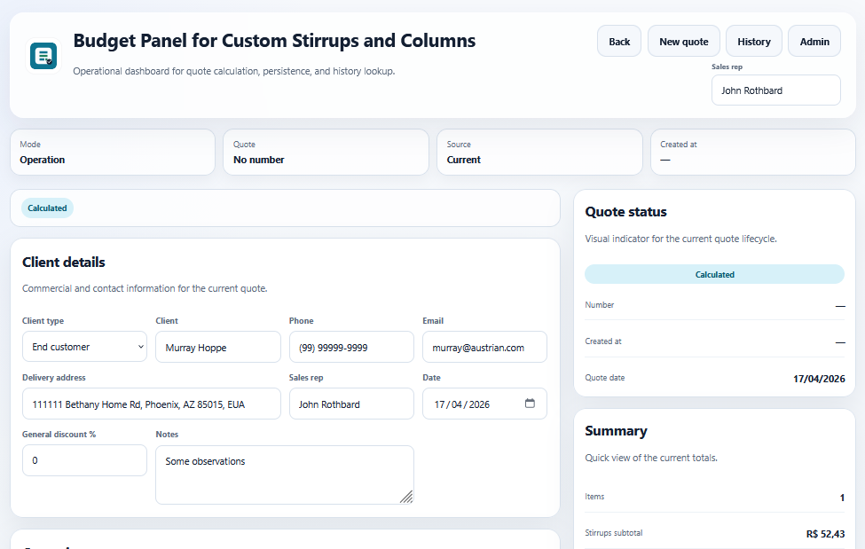
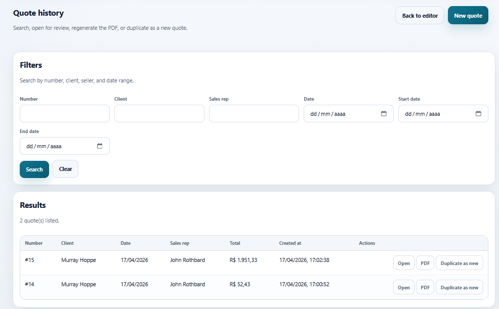
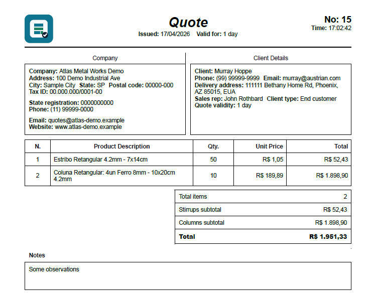

# Quote Panel for Custom Stirrups and Columns

A sanitized public portfolio version of an internal-style quoting web application for custom stirrups and columns.

This project demonstrates a production-oriented workflow for operational quoting: entering client data, assembling custom stirrup and column items, calculating totals, saving quotes, reopening historical quotes, duplicating past quotes safely, and generating printable PDF output.

## Problem It Solves

In this business context, each stirrup and each column can vary by geometry, gauge, spacing, bar count, quantity, and customer type. Because of those combinations, every item can produce a different sales value and must be converted into a formal quote quickly.

Without dedicated software, the salesperson would need to calculate and register each custom item manually before producing a client-ready quote. That costs time, delays customer response, and increases operational friction.

This application solves that problem by turning quote assembly into a structured workflow with fast calculation, persistence, history lookup, PDF generation, and controlled admin settings.

## Why This Project Matters

This project showcases a practical internal-tool scenario combining:
- business workflow design
- custom calculation handling
- persistence and history
- operational UX
- admin-only controls
- browser-based PDF generation

It was designed as a production-oriented quoting workflow rather than a purely academic demo.

## Main Features

- Dashboard workflow for building quotes with client data, notes, and item lists
- Separate quote item flows for custom stirrups and columns
- Quote calculation flow preserved at the application level, using generalized demo-safe formulas in the public version
- Quote save and history lookup using SQLite
- Reopen existing quotes for review
- Duplicate historical quotes into a new quote instead of destructively editing the original
- PDF quote generation directly in the browser
- Admin area for internal price-per-kg configuration and protected controls
- Quick-history access from the sidebar for operational reuse

## Screenshots

### Dashboard editor


### History page


### PDF preview


## Technologies Used

- Frontend: Vanilla JavaScript, HTML, CSS, Vite
- Backend: Python, FastAPI
- Database: SQLite3
- Output: browser print flow for PDF generation

## Architecture Overview

The system is split into a small FastAPI backend and a Vite-based frontend.

- `frontend/` contains the operational dashboard UI, quote state handling, history screen, PDF/CSV/text generation helpers, and admin interactions.
- `app/rotas/calculos.py` contains the existing quote calculation logic for stirrups and columns.
- `app/rotas/orcamentos.py` handles quote persistence, history queries, reopening, duplication support, and safe deletion for admin users.
- `app/rotas/admin.py` exposes admin login and internal price management endpoints.
- `orcamentos.sqlite3` is created locally at runtime and stores quote snapshots plus searchable mirror fields for history and lookup.

More detail is available in [ARCHITECTURE.md](ARCHITECTURE.md).

## How to Run Locally

Requirements:
- Python 3.x
- Node.js and npm

### 1. Backend

```bash
python -m venv .venv
.venv/Scripts/python -m pip install -r requirements.txt
.venv/Scripts/python -m uvicorn app.main:app --reload --host 0.0.0.0 --port 8000
```

On Linux/macOS, replace `.venv/Scripts/python` with `.venv/bin/python`.

### 2. Frontend

```bash
cd frontend
npm install
npm run dev -- --host 0.0.0.0 --port 5173
```

Then open `http://localhost:5173`.

### 3. Optional Windows helper

Use `run_local.bat` after creating the Python virtual environment.

## Notes / Observations

- This repository intentionally excludes any production database or real client/company data.
- The default admin token in the portfolio version is a demo placeholder controlled by `BUDGET_PANEL_ADMIN_TOKEN`.
- Demo price defaults are fictional and exist only to keep the sample app runnable.
- The public version uses generalized demo calculation logic so the app remains realistic without exposing original internal business rules.
- Historical quotes should be reused through duplication as a new quote rather than destructive editing.

## Public Portfolio Disclaimer

This is a sanitized public portfolio version of an internal-style application. Real company identity, client records, pricing data, tokens, addresses, and other sensitive operational information were replaced with fictional demo content for safe public sharing.
